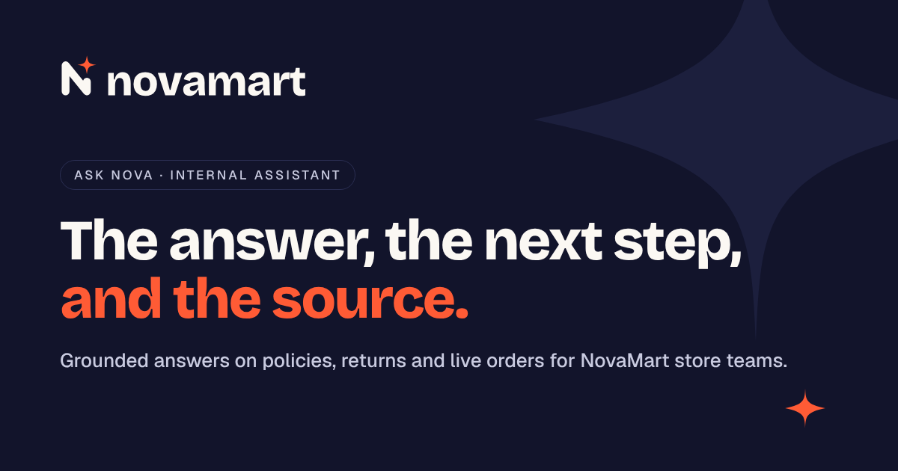

# NovaMart Assist

An internal AI assistant for NovaMart store employees. It answers policy questions from the company documentation, looks up live order data through a tool, declines when the documentation does not cover the question, and turns every decline into a work item for the operations team.

Built on the OpenAI Responses API, running as one Supabase Edge Function, with a web app on top that shows each answer with its sources and the steps the agent took. No agent framework.

**Live:** https://novamart-artefact.lovable.app · **Production note:** [PRODUCTION_NOTE.md](PRODUCTION_NOTE.md) · **Latest eval run:** [evals/results/latest.md](evals/results/latest.md)



## What it does

- Answers questions about returns, exchanges, price match, damaged items, deliveries, gift cards and loyalty points, citing the exact policy section.
- Calls `get_order_status` (a mock of NovaMart's order API) for questions about a specific order.
- Declines with a clear reason when the documentation does not cover the question, instead of guessing. Escalates to Operations when a policy requires a human decision.
- Logs every decline to a knowledge gap table so Operations can see what to document next (see "The idea I would push").

## A three minute tour

On the live link (rate limited, it runs on my API key), the example chips on the first screen cover the brief:

1. **Grounded answer.** "Do we price match Amazon?" The answer cites the sections it used; click one to open the real document with the section highlighted.
2. **Tool call.** "Order NM-1003 shows as delayed. What do I tell the customer?" The agent looks up the order and the card shows the tracker built from the tool output.
3. **Graceful decline.** "What is the employee discount percentage?" Not in the documentation, so Nova says so and points to HR. Open the **Ops console**: the decline is already there as a documentation gap.
4. **Escalation.** "Can a customer return an unopened mattress after 60 days?" Outside the rule, so Nova explains the rule and opens a ticket for Operations instead of deciding.
5. **Quality.** The eval results behind all of this.

## Run it

**Locally, against the deployed agent:**

```bash
npm install
npm run dev               # web app on http://localhost:8080
```

**Your own backend** (Supabase CLI and an OpenAI key):

```bash
supabase link --project-ref <your-project>
supabase db push --include-seed          # tables, policies and mock orders
supabase secrets set OPENAI_API_KEY=sk-...
supabase functions deploy nova
# then set VITE_SUPABASE_URL and VITE_SUPABASE_PUBLISHABLE_KEY in .env
```

**Tests and evals:**

```bash
make test                 # 14 offline tests of the agent loop and retrieval (Deno, no API calls)
make setup                # installs the eval harness and creates evals/.env to fill in
make evals                # 24 eval cases against the deployed agent + LLM judge
```

## How it works

```
store employee (web app)
      |
      v
Supabase Edge Function "nova"  (supabase/functions/nova)
+---------------------------------+     search_policies  ->  BM25 over policy sections
|  agent loop on OpenAI           | --> get_order_status ->  orders table (mock order API)
|  instructions = rules +         | --> escalate_to_ops  ->  tickets table (mock helpdesk)
|  catalog of the documentation   |
+---------------------------------+
      |
      v  respond(status, answer, next_step, sources)
   answered | declined | escalated | needs_info
      |
      v (declined / escalated)
   knowledge_gaps table  ->  Ops console  ->  what Operations should document next
```

A question usually takes 2 to 4 model calls: one or two searches, maybe an order lookup, then `respond`. Each step streams to the browser as it happens.

Repository layout:

```
supabase/
  functions/nova/
    index.ts           HTTP routes, streaming, rate limit
    agent.ts           the agent loop
    tools.ts           tool schemas + what each tool does
    prompt.ts          system instructions
    knowledge.ts       catalog + BM25 search over policy sections
    openai.ts          OpenAI Responses API client (the provider boundary)
    db.ts              database access
    agent_test.ts      offline tests with a fake model and a fake database
  migrations/          schema: policies, orders, knowledge gaps, tickets, rate limit
  policies/            8 invented NovaMart policy documents (markdown, one section per "##")
  orders.json          mock orders
  seed.sql             generated from policies/ and orders.json by scripts/build_seed.py
evals/                 24 cases, harness that calls the deployed agent, reports
src/                   web app (React, TanStack Start, built with Lovable), a thin client
                       (src/components/ui is the standard shadcn/ui kit Lovable generates)
public/brand/          NovaMart logo files
PRODUCTION_NOTE.md     how I would take this to production
```

## The web app

The web app holds no business logic. Every answer comes from the Edge Function, the same endpoint the evals test.

- **Store floor.** The employee asks; the answer streams in as the agent works: "Searching policies for…", "Looking up order NM-1003…". Each answer is a card with the status, the answer, the next step and the sources. Clicking a source opens the real policy document with the cited section highlighted. Order lookups render as an order tracker built from the tool output, so the employee sees the data, not only the summary.
- **Documentation.** Every policy document Nova answers from, read live from the same tables the agent uses. It makes the boundary visible: if a rule is not on this page, Nova declines.
- **Ops console.** The knowledge gap loop as a screen: every decline and escalation with the store and the searches tried, filters by reason, and a button that clusters the gaps into "documents to write".
- **Quality.** The latest eval run, read from `public/evals/latest.json`, which the eval harness writes and is committed with the code.
- **Brand.** NovaMart is invented, so I gave it an identity: logo, palette, type, and the "spark" used as the loader.
- **Next.** Two greyed out menu items, Tickets and Weekly digest, mark the roadmap below. They are labelled as not built; nothing behind them is faked.

## Key decisions

**1. Platform: OpenAI.** It is an ecosystem I ship with in production, and the pieces this problem needs are native: tool calling with strict JSON schemas on the Responses API, automatic prompt caching for the fixed prefix (rules, catalog, tool schemas), and cheap models that handle this well: `gpt-6-luna`, the lowest-cost GPT-6 model, runs the agent, grades the evals and clusters the knowledge gaps. Eight documents and four tools do not need a bigger model; if the evals show Luna failing on a class of questions, `gpt-6.1-sol` is one environment variable away (`NOVA_AGENT_MODEL`). In production I would grade with a different model from the one answering, so the judge does not share the agent's blind spots. The provider boundary is one file (`openai.ts`); the production note explains when I would recommend another platform for NovaMart.

**2. Supabase for runtime and data.** The prototype needs three things to live somewhere: the agent, the documentation, and the gap log that every store writes to. One Supabase project covers the three: an Edge Function, and Postgres tables with row level security on and no public policies. The browser can only call the function; only the function, with the service role, touches the tables.

**3. No framework.** The loop is plain code on the model API. Every step is visible in the trace, testable with a fake model, and there is no abstraction layer to debug when something goes wrong in front of the client.

**4. Retrieval is a tool, not a pre-processing step.** The agent decides when to search and with which words, and can search twice if the first result misses. Questions that only need the order API do not drag policy text into the context. The trade-off is one more model call per question; for an internal assistant that is cheap.

**5. BM25 over sections, no vector database.** Eight documents, about 40 sections. I first tried Postgres full-text search, since the data was already there. It ranked badly on natural questions: `ts_rank` has no inverse document frequency, so common words like "customer" and "return" outweighed the rule that mattered, and the holiday extension fell out of the top 3 for "a customer bought a TV on December 20 and wants to return it on January 10". BM25 in 40 lines (`knowledge.ts`) puts it first, and a test now locks that in. Sections, not fixed-size chunks, keep each rule whole. When the corpus grows, the `search()` contract stays and hybrid retrieval with pgvector goes behind it, in the same Postgres.

**6. The catalog is in the instructions.** The model sees the list of documents and sections on every call. Declining well is as much about knowing what exists as about what retrieval returns. "Employee discount" is not in the catalog, so the agent declines instead of stretching the loyalty policy.

**7. The final answer is a tool call.** `respond` has a `status` enum (answered, declined, escalated, needs_info) and structured `sources`. That makes "declined" a first-class state the evals can assert on, instead of a sentence we would detect with a regex. `tool_choice: required` forces the model to finish every turn with an explicit outcome.

**8. Cite or decline.** An `answered` result must cite a section or come from the order tool (`grounded`). The eval judge then checks that every claim in the answer is supported by the sections the agent actually read.

**9. Degrade honestly.** A `respond` sent together with other tool calls (before seeing their results) is rejected and the model answers again. Free text without `respond` is treated as a decline, never passed on as an answer. If the loop hits the step limit, the employee gets a decline and a pointer to the helpdesk, never a half answer.

**10. A public link with guardrails.** The live link spends a real API key, so the function rate limits per client (10 a minute, keyed by a hash, never the raw IP) and caps the day at 500 questions, on top of a spending limit on the OpenAI project.

## The idea I would push: the knowledge gap loop

The brief says the operations team is overwhelmed. An assistant that answers 80% of questions helps, but the other 20% keep landing on the same people, often the same question many times.

So every decline and escalation is logged with the question, the searches the agent tried and the store. The Ops console lists them, and a small model clusters them into themes and proposes the document or section that would close each one. Operations writes the policy once (a markdown file in `supabase/policies/`, or a row in the table), and the function reloads the documentation every minute, so Nova answers it from the next question on. No retraining, no code change, no deploy.

The loop turns the assistant's weakest moment (not knowing) into the operations team's roadmap. It is the feature I would demo first to the ops lead, because it reduces their inbox, not just the employees' wait.

Two smaller choices for the store floor: the answer format is always "answer, next step, sources", because the employee is usually standing in front of a customer and needs the action, not the policy prose. And the agent answers in the language the employee used.

## Evaluation

`evals/cases.yaml` holds 24 cases in four categories:

- **policy** (12): answers grounded in a section, including edge cases the documents were written to create: the holiday extension overriding the 15-day electronics window, a no-receipt return, Amazon vs. Amazon Marketplace, a refund that needs a manager, one question in Portuguese.
- **tool** (6): order lookups, what to tell a customer about a delayed order, a missing package, an order number that does not exist, and a question with no order number (the agent must ask, not guess).
- **decline** (4): plausible questions that are not in the documentation (employee discount, marketplace returns) and out-of-scope questions (vacation days, weather).
- **edge** (2): a request for an exception outside the window, and a warranty question the documents only partly cover.

The harness calls the deployed function, so it tests what is actually running, not a local copy. Two layers of checking. Deterministic: final status, cited document, tools called or not called, required and forbidden strings, and the grounding rule. Then an LLM judge (`gpt-6-luna`) grades every `answered` case for faithfulness against the exact sections and tool outputs the agent saw. The run writes `evals/results/latest.md` and the JSON the Quality page reads, and exits non-zero below a pass-rate threshold, which is how I would wire it into CI as a release gate.

**Latest run (2026-10-23): 23/24 passed (96%)**, on the deterministic checks only; the LLM judge was not part of this run. Policy 12/12, tool 6/6, decline 3/4, edge 2/2. Full report in `evals/results/latest.md`; the first run is kept next to it (`20261023-0854.md`).

How it got there, in two runs on the same day:

1. **First run: 22/24.** The real miss was `edge-exception-outside-window` (unopened mattress after 60 days): the agent declined, but the escalation policy says requests for exceptions go to Operations, so it should have opened a ticket.
2. **The fix.** One rule added to the prompt (`prompt.ts`, rule 6): a request for an exception is an escalation, not a decline; decline only when no rule covers the topic.
3. **Second run: the mattress case now escalates with a ticket.** The same change made the agent escalate one more case: a missing package on a $499 order. Checking the documents, that is correct. Escalation and Contacts says missing package claims above $300 go to the Operations team, so the case was too strict and now accepts answered or escalated. It is the one change to watch: the rule makes the agent more willing to open tickets, and the decline and escalation rates in production are how I would watch it.

The remaining failure is `decline-employee-discount`. The agent declined correctly and sent the employee to HR, but it cited the HR contacts section, and the case says a decline cites nothing. That is debatable: citing where the HR contact comes from is arguably good behavior. I left the check strict and the failure visible rather than loosen the test after seeing the result.

Two checks were corrected along the way, both because the test was wrong, not the agent: "48 hours" vs. "48-hour" in `policy-delivery-damage-48h`, and the missing package case above. Each correction is commented in `cases.yaml`.

The cases are a regression set, not a benchmark: when a failure is found and fixed, it gets a case so it cannot come back silently.

## Scope, time and AI tools

The brief asks for 4 to 6 focused hours and says UI design is not evaluated, so here is where to look. The part that answers the brief is small on purpose: one Edge Function (seven files, about 870 lines), 8 policy documents, the eval harness and the production note. The brand and the web app go beyond the brief deliberately: NovaMart is the client in this exercise, and I wanted to show what the store team would actually use. They hold no business logic, so you can review the whole agent without opening `src/`.

I built it with AI assistants, as the brief encourages: Claude Code for code, tests and docs, Lovable for the web app. The decisions are mine (platform, Supabase, BM25 over Postgres full-text search, `respond` as a tool, the gap loop, which eval failures to fix and which to leave visible), and I can walk through any line.

## Assumptions

- NovaMart's documentation can be kept as markdown with one heading per rule. The invented documents are short and deliberately overlap (returns vs. exchanges, final sale vs. defective) to exercise the agent.
- The order API returns a status vocabulary that matches the delivery policy, so the agent can map a status to what to tell the customer.
- Store employees identify themselves by store id (the store picker in the app); authentication is out of scope for the prototype.
- "Decline gracefully" means: say what is not covered, point to the helpdesk, log the gap. It does not mean refusing to help; a `needs_info` state covers the case where one detail is missing.

## What I would do with more time

1. Run the eval suite against a baseline before every prompt or retrieval change, and keep the diff in the report. Prompt changes that "feel" better often score flat.
2. Multi-turn evals. The app keeps a short history, but the cases are single-turn.
3. Hybrid retrieval behind the same `search()` contract, with a metadata filter by region or store format, which is where policy variants usually differ.
4. A real ticket integration (Jira or the helpdesk tool NovaMart already uses) and a weekly gap digest sent to the ops lead automatically.
5. A thumbs up/down on each answer card, feeding the eval set.
